# Product Motion Studio

**One-click product animation studio for Blender** — camera, motion, lights, backdrop, floor, look and render settings built around your model in seconds.


[](docs/media/juicy_salif_film_16x9.mp4)

*Juicy Salif (Philippe Starck, 1990): a 15-second film built only with PMS presets and live controls, rendered in Cycles.*

▶ [Watch the full-quality video (MP4, 1920×1080)](docs/media/juicy_salif_film_16x9.mp4)

## Why

Setting up a product shot in Blender — camera framing, motion curves, lighting rigs, backdrop gradients, floor materials, color grading, render settings — takes hours of manual work. Product Motion Studio builds the entire studio around your selected object with one click, then lets you tweak every parameter live without rebuilding.

## How it works

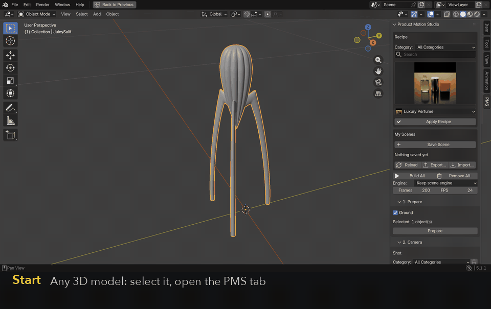

<table>
<tr>
<td>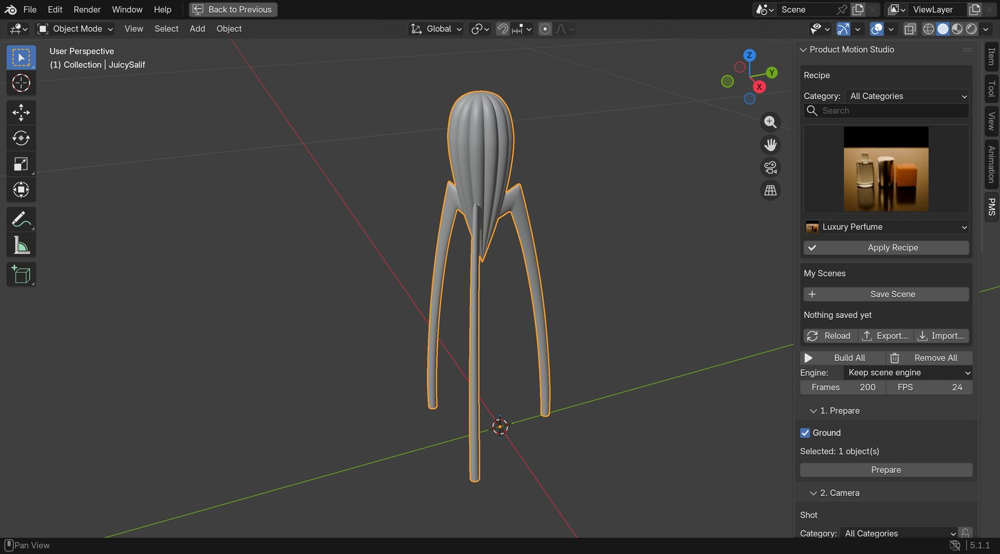<br><sub>Select your model, press N and open the PMS tab.</sub></td>
<td>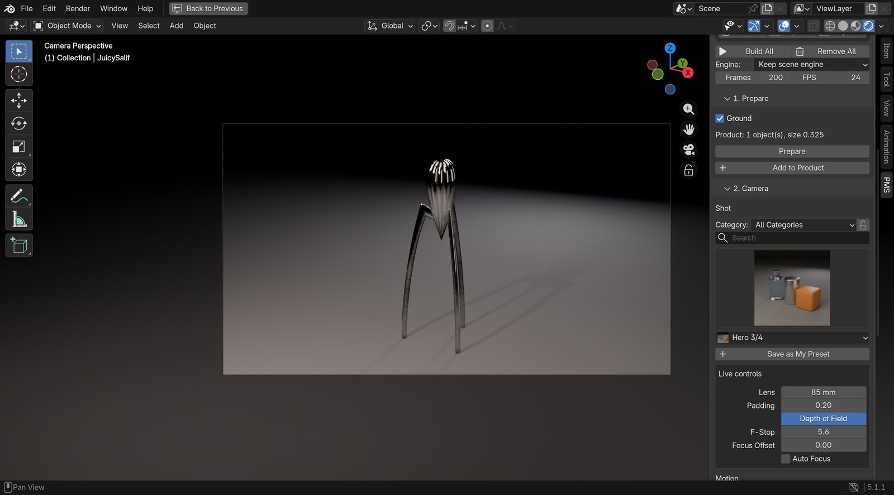<br><sub>1. Prepare: one click analyses the product and builds the whole studio around it.</sub></td>
</tr>
<tr>
<td>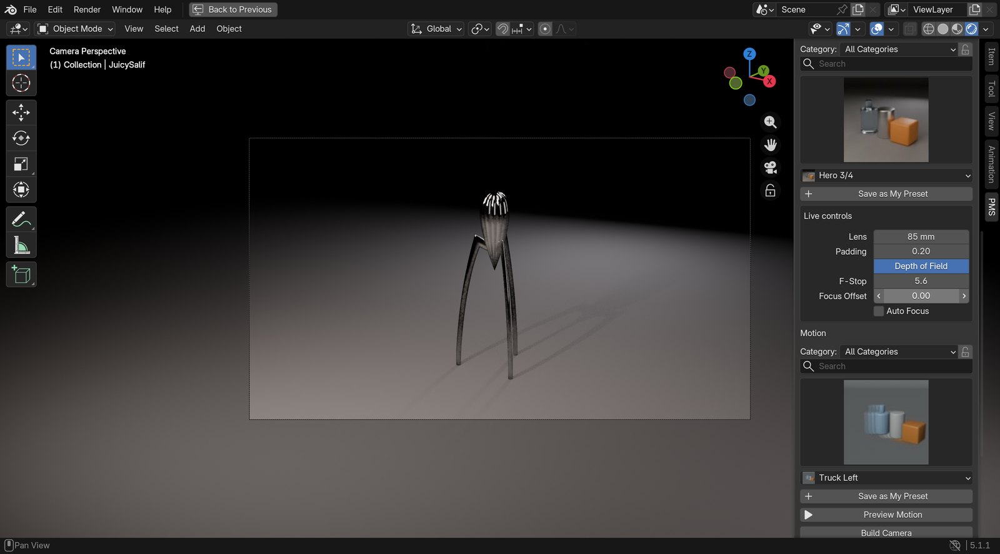<br><sub>Camera: shot type and camera motion, with live lens, padding and depth of field.</sub></td>
<td>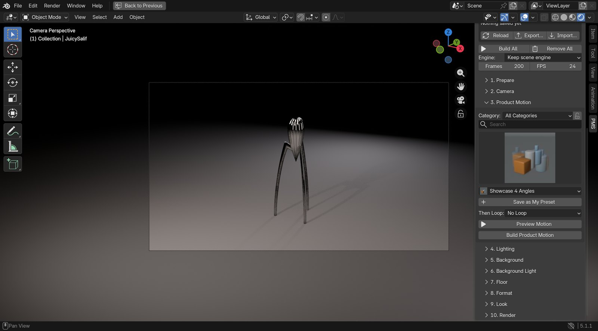<br><sub>Product motion: spins, reveals, loops and more.</sub></td>
</tr>
<tr>
<td>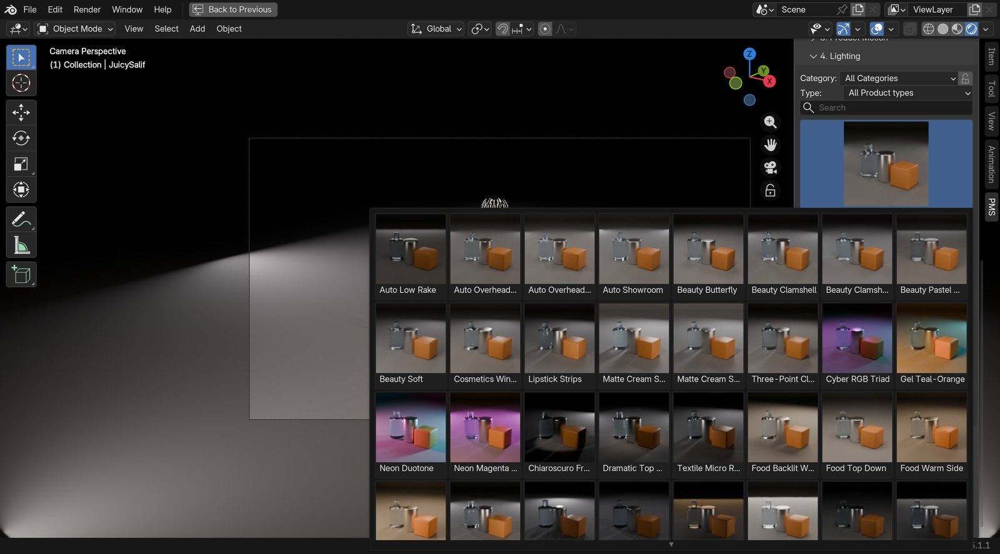<br><sub>Every section has a thumbnail browser (here: the lighting rigs).</sub></td>
<td>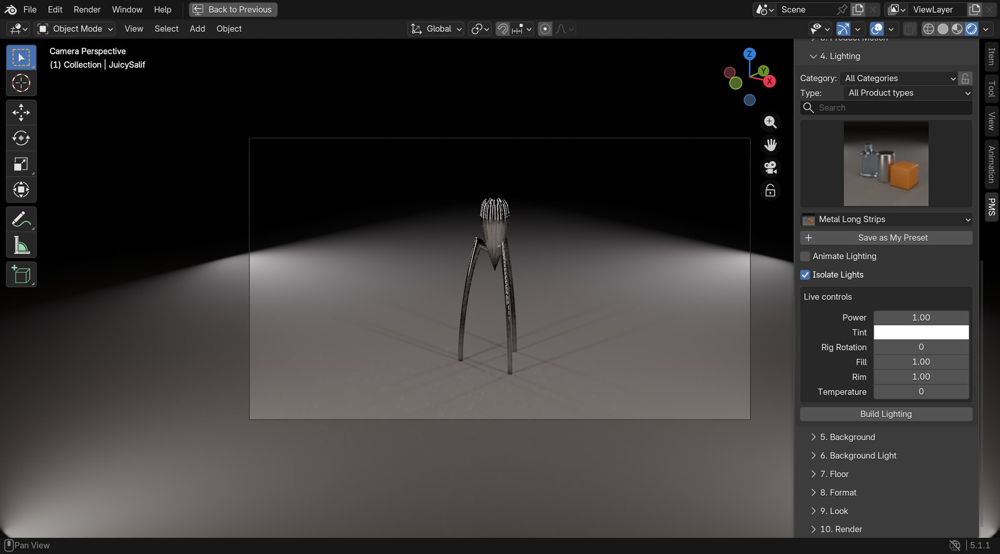<br><sub>Lighting: pick a rig, then tune power, tint and rotation live.</sub></td>
</tr>
<tr>
<td>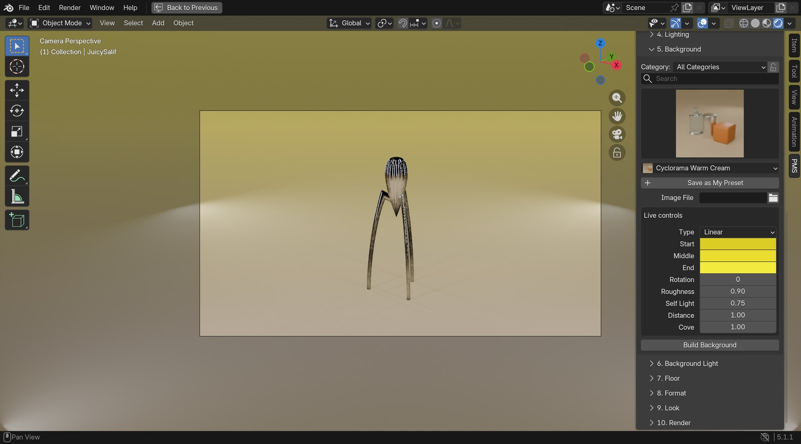<br><sub>Background: cycloramas, gradients, 360° studios or your own image.</sub></td>
<td>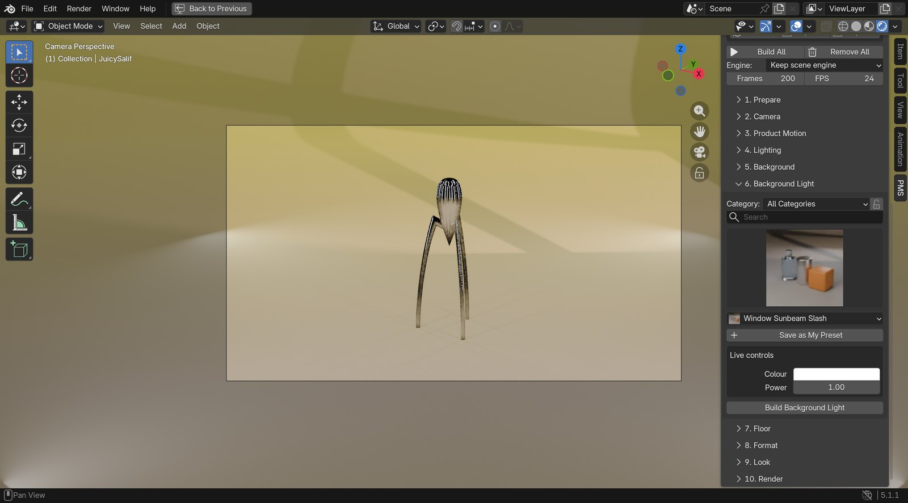<br><sub>Background light: washes, spots and gobo patterns on the backdrop.</sub></td>
</tr>
<tr>
<td>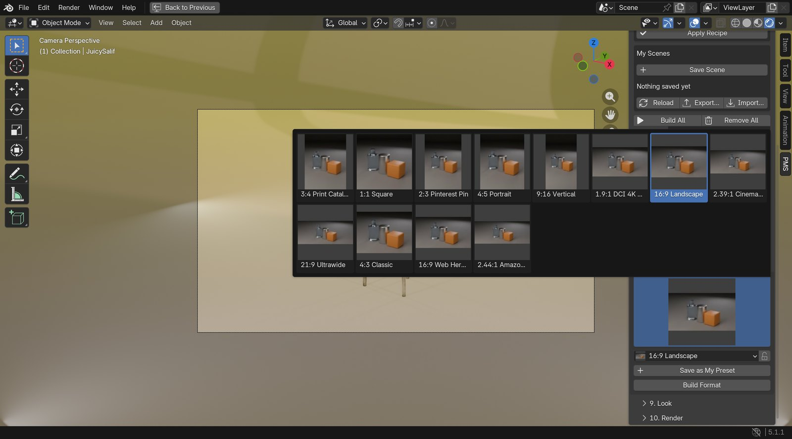<br><sub>Format: aspect ratios for every platform.</sub></td>
<td>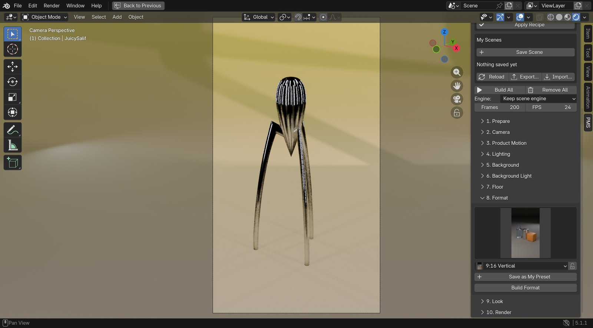<br><sub>The same scene in 9:16: the camera refits the product.</sub></td>
</tr>
<tr>
<td>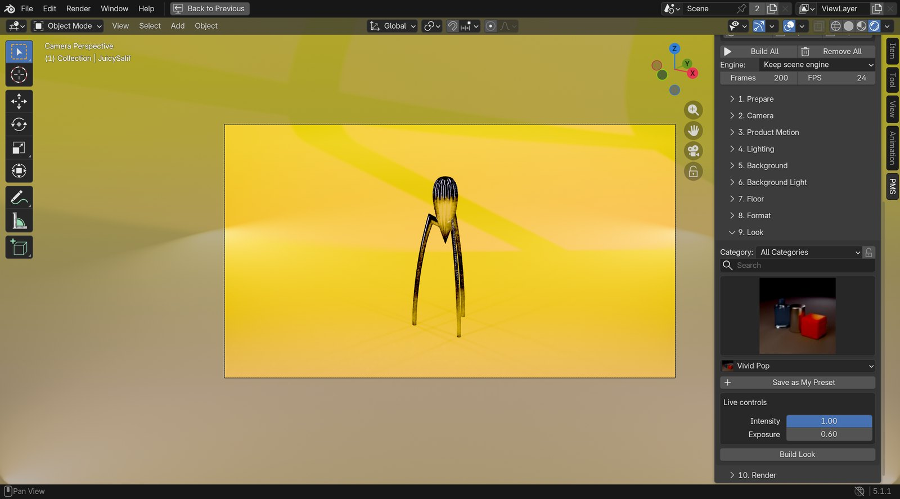<br><sub>Look: colour and film looks with live intensity and exposure.</sub></td>
<td>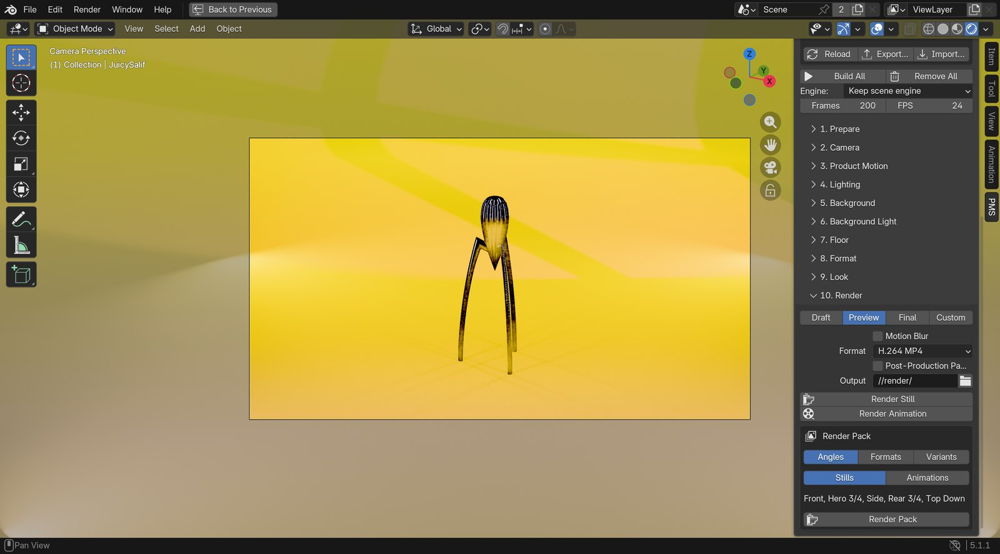<br><sub>Render: Draft / Preview / Final quality, MP4 or PNG sequences.</sub></td>
</tr>
<tr>
<td>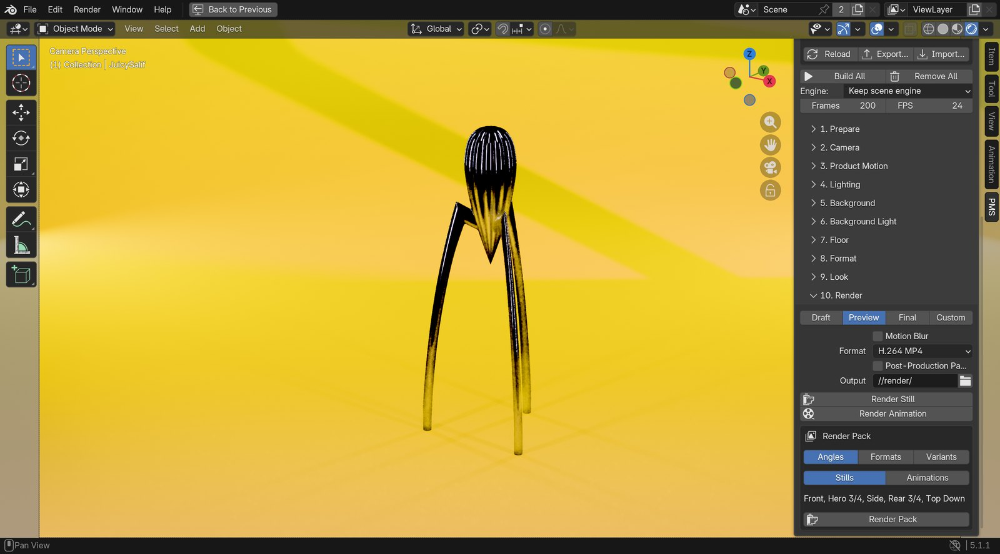<br><sub>The result, ready to render.</sub></td>
<td></td>
</tr>
</table>

## Features

| Area | What you get |
|------|--------------|
| 🎬 **One-click recipes** | 22 complete styles (luxury perfume, tech launch, sneaker drop, turntable catalogue…) that set all 9 sections + duration |
| 🔒 **Section locks on recipes** | Lock any section (Lighting, Background, etc.) so Apply Recipe keeps your hand-tuned values |
| 🔍 **Textual search** | Filter presets by id, name, description or tags in every section, combined with Category/Type filters |
| 🔄 **Product motion** | 63 presets: spins, drifts, reveals, impacts, flips, fly-bys, loops, exploded views — all with measured peak speed, acceleration and floor-clearance |
| 🎥 **Camera** | 17 shot types × 30 motion presets (orbit, dolly, crane, whip, rack focus, handheld, truck, helical, telephoto snap, micro breathing…) with C²-continuous curves |
| 🔒 **Auto Focus** | Ray-cast from camera to product surface each frame → live focus distance keys; works with DoF and focus offset |
| 🔁 **Intro + Loop** | Combine an intro motion with a looping tail; keys baked to a single clean action for camera fit and manual tweaks |
| 💡 **Lighting & backdrop** | 70 lighting rigs (beauty, rim, glass, metal, jewellery, tech, food, automotive, high-key, low-key…) + 31 backdrops (cycloramas, gradients, 360° studios, plinth/steps, material surfaces, your own image) + 12 background lights (washes, spots, gobo patterns, neon bar) + 12 floors (matte, glossy, mirror, shadow catcher, procedural asphalt, obsidian, acrylic, water) |
| 🎨 **Look & render** | 42 color/film looks (film stocks, filters, stylised grades) + 12 formats (16:9, 9:16, 1:1, 4:5, 21:9, 4:3, 2.39:1, 2:3, 3:4, 1.9:1, 2.44:1, 16:9_720) — Draft/Preview/Final/Custom quality, MP4 or PNG sequences, EXR multi-layer passes |
| 🔌 **Key/fill ratio, global temperature, cyclorama size** | Live controls: fill/rim power, kelvin temperature (normalised luminance), backdrop distance & cove |
| 📦 **Batch render (Render Pack)** | Angles (front, hero_34, side, rear_34, top_down), formats (multi-format), variants (collection objects one by one) — restores scene exactly |
| ⚡ **Live controls** | Lens, padding, DoF, f-stop, light power/tint/rotation, backdrop gradient colors/type/rotation, floor color/roughness, look intensity/exposure — all update instantly |
| 💾 **Your presets & scenes** | Save any section or the whole studio (with hand edits) as personal presets with thumbnails; export/import JSON bundles to share |
| 🛡 **Coverage check** | Warns when the camera sees past the backdrop ("void"), listing the frames and a fix tip per backdrop type |
| 🐍 **Python API** | `build`, `apply_recipe`, `set_live`, `set_render`, `save_preset`, `save_scene`, `export_user`, `import_user`, `state`, `render_pack`… — designed for scripts and AI agents (Claude + Blender MCP) |

## Recipes

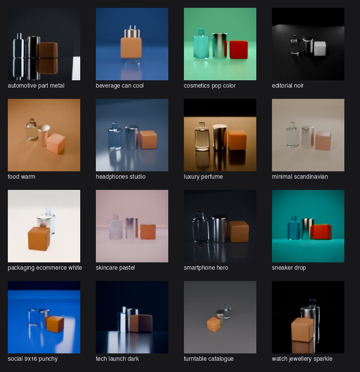

*The image above shows the first 16 of the 22 recipes.*

The 22 built-in recipes: **luxury perfume**, **skincare pastel**, **tech launch dark**, **smartphone hero**, **sneaker drop**, **watch & jewellery sparkle**, **beverage can cool**, **food warm**, **packaging e-commerce white**, **automotive part metal**, **headphones studio**, **cosmetics pop color**, **minimal scandinavian**, **editorial noir**, **social 9:16 punchy**, **turntable catalogue**, **craft spirits amber**, **eyewear acetate sun**, **gaming rgb hardware**, **architectural decor**, **sport supplement bold**, **diamond ring macro**.

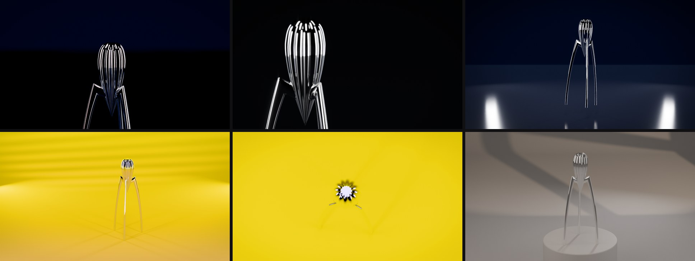

One frame from each of the six shots of the film above, rendered in Cycles.

## Preset library

| Section | Count | Examples |
|---------|-------|----------|
| Product Motion | 63 | `spin_360_loop`, `pop_in_reveal`, `luxury_drift`, `exploded_z_reveal` |
| Camera Shot | 17 | `hero_34`, `macro`, `low_angle`, `detail_corner_crop`, `packshot_tele_85mm` |
| Camera Motion | 30 | `orbit_360_loop`, `push_in`, `whip_orbit_finale`, `truck_left`, `helical_push_orbit` |
| Lighting | 70 | `beauty_soft`, `dark_luxury_contour`, `glass_edges`, `textile_micro_rake`, `cyber_rgb_triad` |
| Background | 31 | `cyclorama_studio_grey`, `cyclorama_radial_spotlight`, `image`, `arch_plinth_pedestal`, `travertine_stone_studio` |
| Background Light | 12 | `soft_wash`, `spot_pool`, `rim_glow`, `venetian_blinds_gobo`, `horizon_neon_bar` |
| Floor | 12 | `matte`, `glossy`, `mirror`, `shadow_catcher`, `obsidian_black_glass`, `rippled_water_pool` |
| Format | 12 | `16:9`, `9:16`, `1:1`, `2:3`, `3:4`, `1.9:1`, `2.44:1`, `16:9_720` |
| Look | 42 | `clean_commercial`, `dark_editorial`, `film_warm`, `kodak_portra_creamy`, `cyber_acid_editorial` |
| Recipe | 22 | `luxury_perfume`, `tech_launch_dark`, `turntable_catalogue`, `craft_spirits_amber`, `diamond_ring_macro` |

**Total: 311 built-in presets**, browsable as thumbnails in the panel, plus your own presets and scenes.

## Installation

**User**
1. Download `product_motion_studio-0.3.0.zip` from the [Releases](https://github.com/eliaaventuri/product-motion-studio/releases) page — **do not unzip it**
2. Blender → Edit → Preferences → Get Extensions → top-right menu → Install from Disk → select the zip
3. Enable "Product Motion Studio"

**For developers**
```bash
./tools/install_dev.sh
```
Creates a symlink into your Blender extensions folder and enables the add-on.

**Run tests**
```bash
blender -b --factory-startup --python tests/test_addon.py
```
165 headless tests across 19 test files (motion quality, camera quality, framing, live controls, user presets, state, prepare, addon, batch, locks & search, autofocus, gobo, exploded views, intro + loop, extra shots, extra backdrops, light/backdrop, render extras, calibration).

## Quick start

1. Select your product object(s) in the 3D Viewport
2. Press **N** and open the **PMS** tab
3. Pick a **Recipe** from the thumbnails (e.g. *luxury perfume*) and click **Apply Recipe**, or choose a preset per section and click **Build All**
4. Fine-tune with the **Live controls** in any section (lens, light power, backdrop colours, look intensity…): changes apply instantly
5. In **10. Render**, choose **Final** and click **Render Animation**

## Scripting & AI agents

```python
# installed as an extension:
import bl_ext.user_default.product_motion_studio.api as api

# Apply a complete recipe
api.apply_recipe("luxury_perfume")

# Or build step by step
api.build(
    shot="hero_34",
    product_motion="spin_360_loop",
    camera_motion="orbit_360_loop",
    lighting="beauty_soft",
    background="cyclorama_studio_grey",
    background_light="soft_wash",
    floor="matte",
    format="16:9",
    look="clean_commercial",
    duration=200
)

# Tweak live
api.set_live(cam_lens=85, light_power=1.2, light_tint=(1, .9, .8))

# Render settings
api.set_render('FINAL', motion_blur=True, fmt='MP4', mode='animation')
```

The API is designed for **Claude + Blender MCP** — give the agent a brief and it drives the add-on for you.

## Companion skill for Claude

**Product Animation Director for Blender** (paid, on Agensi) — an art-director skill that produces a brief & shot list, prepares CAD models, assigns materials, designs lighting & camera, animates with overshoot/settle/weight, grades the look, renders, runs measurable checks, and drives PMS through its API across 12 workflows (brief → prepare → materials → lights → camera → animate → preview → check → critique → variants → render → full spot).

👉 **[Get the skill on Agensi](https://agensi.io/skills/product-animation-director-blender-spots-brief-to-render)** · the add-on itself stays free and open source.

## Measured quality

- **Motion**: All product-motion presets rewritten with absolute-time curves — peak-speed, C² continuity, loop-seam C¹ and floor-penetration violations reduced **169 → 0**
- **Camera**: All camera-motion presets with C² ramps, peak-speed caps, no abrupt starts/stops — violations **227 → 0** (declared exceptions: `whip_orbit_finale` ~170°/s, `dolly_zoom`/`rack_focus` change lens, `handheld` noise < 0.9° p-p, `telephoto_snap_zoom`/`micro_breathing_macro`/`beat_pulse_120bpm`/`showcase_4_angles_snap`/`zero_gravity_tumble_loop` per test_camera_quality)
- **Framing**: Product fills **~75% of frame height** in 16:9 across the animation (was 30–70%)
- **Recipes**: the first 16 verified in Cycles & Eevee — clipping **≤ 0.5%**, Eevee luminance within **±0.06**; newer lights, looks and recipes calibrated with `tools/calibrate.py` (luminance and clipping, Eevee vs Cycles)
- **Test suite**: **165 automated headless tests pass** (19 test files)

## Known limitations

- Mirror floor in Eevee shows a black band (screen-space reflections miss off-screen geometry) — correct in Cycles
- Metals in Eevee require ray-tracing (enabled automatically on build)
- Coverage check detects geometric voids, not whether the backdrop is *lit* in dark areas
- Very short animations (< 30 frames) can exceed `frame_end` on some motions
- Vertical formats keep wide product groups small (width-limited)
- Auto Focus keeps the product surface sharp, so `rack_focus` no longer pulls focus while it is on
- Neon bar and gobos follow the camera azimuth, not its elevation

## Roadmap

- More recipe styles (jewellery macro, automotive hero, cosmetic splash…)
- Native Blender Extensions platform packaging (one-click install from Blender's Get Extensions)
- Video tutorials for each workflow

## License

GPL-3.0-or-later — free and open source.

## Author

**Elia Venturi** — [github.com/eliaaventuri](https://github.com/eliaaventuri)

---

⭐ If this add-on saves you time, please **star the repo** and open an issue for bugs or feature requests.